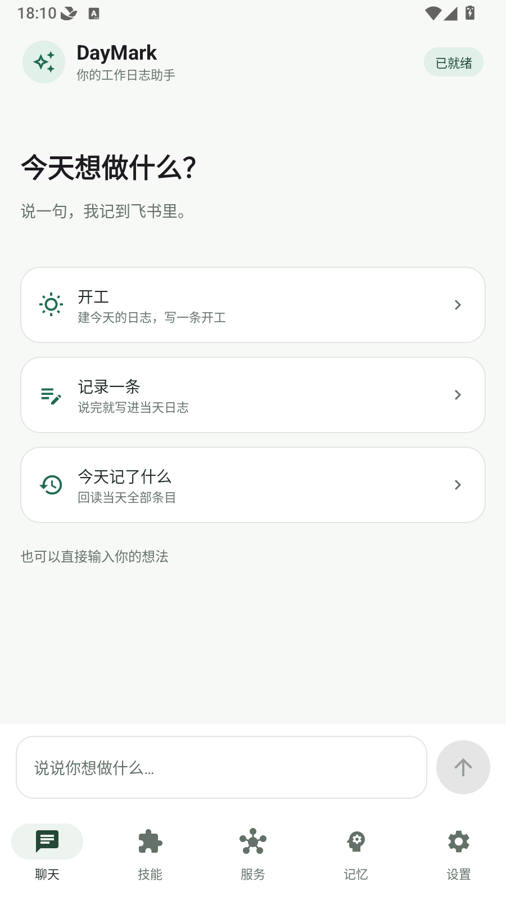
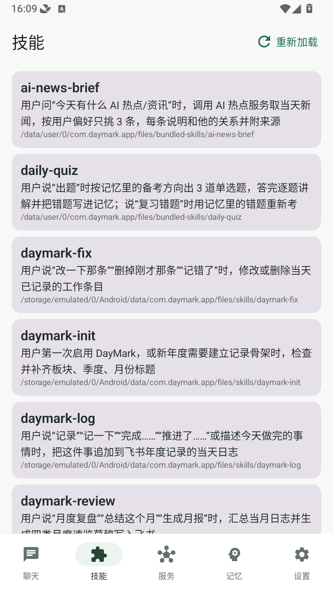
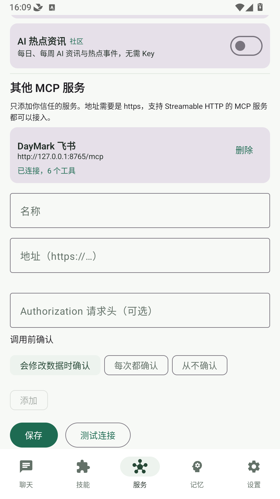

# DayMark · 行知工作助理

> 说一句「开工」，它把今天记到飞书；做完一件事说「记录：……」，它原样追加；月底说「总结这个月」，它出速览草稿。

DayMark 是一个跑在安卓手机上的个人工作日志 Agent：聊天界面背后是技能（SKILL.md）+ MCP 工具层 + 飞书云文档，既能对话记录，也能通过无障碍服务替你操作其他 App。



## 下载

最新安装包在 [Releases](https://github.com/weidong/daymark-agent/releases/latest)（debug 签名，自用测试，不要用于正式分发）。打 `v*` 标签会自动构建 APK 并发布，流程见 `.github/workflows/release.yml`。

## 它能做什么

| 能力 | 说法 | 落到哪 |
|---|---|---|
| 开工 | 「开工」 | 当天日期标题下写一条「开工」，重复执行自动跳过 |
| 记录 | 「记录：完成结营作业」 | 原文追加到当天标题下，不加评价、写完回读校验 |
| 补记 | 「补记 11-14：……」「改成……」 | 自动补建历史日期标题，修改/删除前先确认 |
| 回读 | 「今天记录了什么」 | 按日期列出当天全部条目 |
| 复盘 | 「总结这个月」 | 生成月度速览草稿（带【草稿】标记） |
| 操作手机 | 「打开设置里的 Wi-Fi 页面」 | 无障碍服务读屏 + 点击，需要手动开启 |

## 它是怎么跑通的

```
聊天输入 → Agent（选技能） → 技能规则（SKILL.md）
                              ├─ MCP 工具层（6 个工具）→ 飞书云文档
                              └─ 无障碍服务（hands）→ 其他 App
```

- **技能**：`skills/daymark-*`，纯 Markdown，热加载，不写死代码
- **工具层**：`tools/mcp/daymark_mcp_server.py`，Streamable HTTP MCP，暴露 `daymark_today` / `daymark_append` / `daymark_read` / `daymark_update` / `daymark_delete` / `daymark_month`
- **手机操作**：`hands` 模块的无障碍服务，聊天模型与操作模型分开配置（操作模型需支持读图）

 

## 目录

| 目录 | 内容 |
|---|---|
| `app` | 手机端界面：聊天、技能、服务（MCP）、记忆、设置 |
| `core-agent` / `core-api` / `core-llm` / `core-mcp` / `core-memory` / `core-skills` / `core-sentinel` | Agent 内核：会话、模型调用、MCP 客户端、记忆、技能加载、安全闸门 |
| `hands` / `ios-hands` | 无障碍读屏与点击 |
| `cli` | `daymark.py`：lint、push 技能 |
| `tools/feishu` | 飞书 OpenAPI 客户端（today / append / show / month / review） |
| `tools/mcp` | DayMark MCP 服务（飞书 6 个工具） |
| `skills` | 技能：`daymark-init`、`daymark-start`、`daymark-log`、`daymark-fix`、`daymark-review` |
| `web-server` / `deploy` | 可选的自建服务端与部署脚本 |
| `docs` | 架构、技能、MCP、UI 交互、iOS 说明 |

## 快速开始

### 1. 环境

- JDK 17、Android SDK（platform 35、build-tools 35.0.0）
- Python 3（CLI 与 MCP 服务）
- 一台安卓 8.0+ 设备或模拟器

### 2. 构建与安装

```bash
./gradlew :app:assembleDebug
adb install -r app/build/outputs/apk/debug/app-debug.apk
```

包名 `com.daymark.app`，桌面显示 DayMark。

### 3. 配置模型

打开 App → 设置，聊天模型与操作模型各填一组：

| 字段 | 示例 |
|---|---|
| Base URL | `https://ark.cn-beijing.volces.com/api/v3` |
| 模型名称 | `doubao-seed-2-1-pro-260915` |
| API Key | 你自己的火山方舟 Key |

操作模型必须支持读图，否则无法理解屏幕。修改模型配置会重建 Agent 并清空当前对话。

### 4. 接入飞书（MCP）

```bash
python tools/mcp/daymark_mcp_server.py          # 默认监听 8765
adb reverse tcp:8765 tcp:8765                   # 让模拟器/手机能访问
```

在 App「服务」页填 `http://127.0.0.1:8765/mcp`，点「测试连接」应显示「已连接，6 个工具」。飞书凭据放在本地 `.env`（参考 `.env.example`），不要提交到仓库。

### 5. 安装技能

```bash
adb push skills/daymark-start/SKILL.md /sdcard/Android/data/com.daymark.app/files/skills/daymark-start/SKILL.md
```

推完在 App「技能」页点「重新加载」。也可以直接让 App 使用内置示例技能。

### 6. 命令行

```bash
python cli/daymark.py lint skills/daymark-log                    # 技能格式校验
python tools/feishu/feishu_client.py today                       # 写开工
python tools/feishu/feishu_client.py append "完成一件事"          # 追加记录
python tools/feishu/feishu_client.py show                        # 回读当天
python tools/feishu/feishu_client.py review --month 2026-11      # 月度速览
```

## 构建与测试

```bash
./gradlew test :app:assembleDebug
(cd cli && python3 -m unittest discover -s tests -v)
python3 cli/daymark.py lint skills/examples/*/
```

CI 配置见 `.github/workflows/ci.yml`，每次 push 到 `main` 与所有 PR 都会跑一遍。

## 隐私与边界

- 模型 Key、飞书凭据只存在手机设置与本地 `.env`，不写进代码与技能
- 删除、覆盖已确认总结、新建年度文档前都会先问
- 付款、发送、删除类操作有安全闸门（`core-sentinel`）
- 无障碍服务只在你手动开启后生效

## 来源与许可

- 基于开源项目 [aduoge/xiaoman](https://github.com/aduoge/xiaoman) 改造，遵循 MIT License，原始说明见 `README.xiaoman.md`，归属声明见 `NOTICE`
- 名称、包名、图标与界面均已与上游区分；本项目为个人学习与自用改造，非官方版本

## 文档

`docs/ARCHITECTURE.md`、`docs/skills.md`、`docs/mcp.md`、`docs/ui-interaction.md`、`docs/web.md`、`docs/ios.md`
